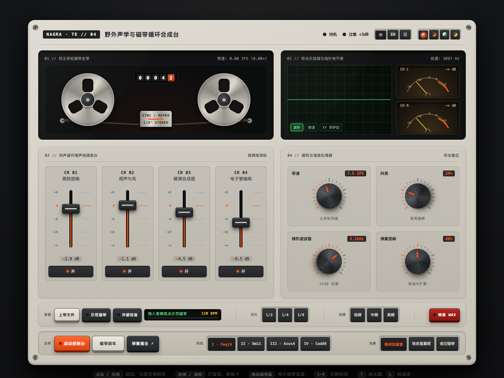

# NAGRA · TE // 04 — Field Acoustic & Magnetic Loop Synthesizer

> **Tactile Industrial Hardware in Pure WebAudio & 120Hz Spring Physics.**  
> 零依赖单文件运行的精密机械触感声学控制台。



---

## 🎛️ 在线体验 (Live Demo)

- **GitHub Pages**: [https://zansgit.github.io/field-console/](https://zansgit.github.io/field-console/)
- **无需安装任何依赖**，现代浏览器（Chrome / Safari / Edge / Firefox）打开即玩。
- **推荐佩戴耳机**以体验 3ms 微动脉冲音效与双向磁带搓碟。

---

## ✨ 核心特性 (Features)

- **1. 双主导轮物理走带 (Dual-Capstan Tape Transport)**
  - 7.50 IPS 恒速飞轮伺服与 5 位机械滚轮计数器实时跳字。
  - **直接物理搓碟**：按住旋转铝盘左右拖拽，实现真实的正反向倒带搓碟（Reverse Scrubbing）与惯性变调。
  - **飞轮摩擦刹车 (Tape Brake)**：按住刹车键（或长按空格）产生物理摩擦阻尼慢放降调。

- **2. 120Hz 阴极荧光示波与双路指针表 (Phosphor CRT & Ballistic VU)**
  - 三模实时示波器切换：`WAVE` (时域波形) / `SPECTRUM` (64段频谱) / `XY LISSAJOUS` (李萨如立体声相位轨迹)。
  - 双路弹道学机械 VU 指针：真实弹簧过冲与回落阻尼。
  - `OVERLOAD +3dB` 峰值红灯与低频机壳物理微震联动。

- **3. 四声道磁吸阻尼推子台 (4-Channel Acoustic Mixer)**
  - 4 路纯数学算法实时合成环境声场：
    - `CH 01` 黑胶静电底噪 (Vinyl Dust & Hiss)
    - `CH 02` 铁皮屋暴雨狂风 (Rain & Wind Acoustic Filter)
    - `CH 03` 暖调多音合成器 (Warm Poly Synth Pad)
    - `CH 04` 电子管低频 (Tube Mains 58Hz Hum)
  - `0.0 dB` 物理磁吸定位点与微动开关滑动反馈。

- **4. 滚花棘轮编码器与弹簧混响 (Stepped Rotary Processors)**
  - 旋钮每拧动一格刻度均由 WebAudio 实时合成 3ms 微动开关咔哒声。
  - `24dB 梯形低通滤波 (140Hz – 13kHz)`、`WOW & FLUTTER 磁带抖晃`、`立体声弹簧混响罐`。
  - `SPRING CRASH ⚡` 一键物理敲击弹簧混响罐金属雷鸣。

- **5. 音乐上带 · 节拍切片 · 16-Bit WAV 导出 (Tape Slicer & WAV Recorder)**
  - 支持拖入任意本地 `MP3 / WAV / FLAC` 音频或使用内置 `DEMO TAPE` 示范磁带。
  - BPM 自动包络测速，按住 `1/2` · `1/4` · `1/8` 拍切片键（或键盘 `Q / W / E`）进行卡带式鬼畜循环。
  - `LOW / MID / HIGH` 三频段 -38dB 瞬时杀频器。
  - `REC WAV` 一键录制立体声母带并直接下载无损 `.wav` 文件。

- **6. 四款阳极氧化工业涂装 × 三国语言丝印**
  - **象牙机壳 (Ivory · Nagra/TE)**：暖灰铝合金 + 国际工程橙
  - **深空石墨 (Graphite Dark)**：暗黑喷砂机壳 + 琥珀橙流光
  - **博朗白 (Braun White · Dieter Rams)**：哑光浅白烤漆 + 鼠尾草绿
  - **钴蓝工作室 (Cobalt Studio)**：深海蓝铝壳 + 信号黄铭牌
  - 面板支持 **中 / EN / 日** 三国丝印一键无缝热切换（快捷键 `L` 换语言、`T` 换主题）。

---

## ⌨️ 快捷键 (Keyboard Shortcuts)

| 按键 | 功能 |
| :--- | :--- |
| `Space` | 点击启动/停止走带；长按触发飞轮摩擦刹车 (Tape Brake) |
| `1` ~ `4` | 切换合成器和弦色彩 (I Fmaj9 / II Dm11 / III Asus4 / IV Cadd9) |
| `Q` / `W` / `E` | 按住触发 1/2 · 1/4 · 1/8 拍 BPM 节拍切片 (Stutter Roll) |
| `T` | 循环切换 4 套机壳主题 (Ivory / Graphite / Braun / Cobalt) |
| `L` | 循环切换 3 国面板丝印语言 (中文 / English / 日本語) |
| 拖拽磁带盘 | 鼠标直接按住上方旋转铝合金盘进行正反倒带打碟 |
| 滚轮 / 拖拽 | 拧动带阻尼金属旋钮与推子 |

---

## 🛠️ 本地运行 (Local Run)

单文件零依赖，直接用任意 HTTP 服务器托管即可：

```bash
# Python
python3 -m http.server 8080

# 或使用 Node / npx
npx serve .
```

打开浏览器访问 `http://localhost:8080` 即可开始把玩。

---

## 📜 许可证 (License)

MIT License © 2026 acezan (zansgit)
